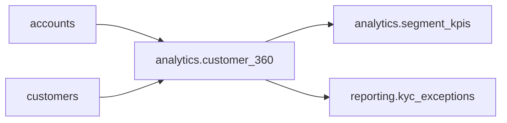

# Data governance report

As of 2026-10-14 12:00

## 1. Data quality

| Dataset | Column | Check | Failed rows | Status |
|---|---|---|---|---|
| accounts | account_id | not_null | 0 / 1000 | PASS |
| accounts | account_id | unique | 0 / 1000 | PASS |
| accounts | customer_id | not_null | 0 / 1000 | PASS |
| accounts | customer_id | references | 1 / 1000 | FAIL |
| accounts | card_number | luhn | 0 / 1000 | PASS |
| accounts | balance | range | 1 / 1000 | FAIL |
| customers | customer_id | not_null | 0 / 501 | PASS |
| customers | customer_id | unique | 2 / 501 | FAIL |
| customers | customer_id | regex | 0 / 501 | PASS |
| customers | email | not_null | 0 / 501 | PASS |
| customers | email | regex | 1 / 501 | FAIL |
| customers | segment | allowed_values | 1 / 501 | FAIL |
| customers | kyc_status | not_null | 1 / 501 | FAIL |
| customers | kyc_status | allowed_values | 0 / 501 | PASS |
| customers | updated_at | freshness<=24h | 0 / 501 | PASS |

**Quality score: 99.93%** (6 failing checks)

## 2. PII discovery

| Dataset | Column | Detected | Match rate | Declared | Required | Status |
|---|---|---|---|---|---|---|
| accounts | card_number | card_number | 100.0% | restricted | restricted | ok |
| customers | email | email | 99.8% | pii | pii | ok |
| customers | ssn | ssn | 100.0% | restricted | restricted | ok |
| customers | notes | phone | 33.6% | internal | pii | UNDER-CLASSIFIED |

## 3. Masking

Created 8 role-specific secure views. What an `analyst` sees:

| customer_id | full_name | email | ssn | date_of_birth |
|---|---|---|---|---|
| C00000 | O********* | 1e2bd0846405dbd1a13838495ffdfd547d147e4a5a3150579afdcdc6f820c1f2 | ***REDACTED*** | 1966 |
| C00001 | O******* | 4d135012a6260bf7be214bba235396281b932426ac4c910738e3a383003ff340 | ***REDACTED*** | 1953 |
| C00002 | P*********** | cd7cd222ea5a4fe49a6eb52e136f2e8b63e4dfced4636f5bbad048b709d0b822 | ***REDACTED*** | 1971 |

## 4. Lineage

`reporting.kyc_exceptions` depends on: accounts, analytics.customer_360, customers

## 5. Access control review

| Severity | Control | User | Detail |
|---|---|---|---|
| HIGH | leaver_access | grace | analyst on accounts still granted after termination |
| HIGH | missing_approval | frank | admin on customers has no recorded approver |
| HIGH | segregation_of_duties | dan | holds both data_engineer and approver |
| HIGH | self_approval | dan | approver on access_requests approved by the grantee |
| MEDIUM | dormant_grant | erin | pii_reader on accounts last used 2026-03-28 |
| MEDIUM | pii_read_via_masked_role | alice | 36 queries touched PII columns of customers; served masked, confirm need |
| MEDIUM | pii_read_via_masked_role | bob | 49 queries touched PII columns of customers; served masked, confirm need |
| MEDIUM | pii_read_via_masked_role | dan | 31 queries touched PII columns of accounts; served masked, confirm need |
| MEDIUM | pii_read_via_masked_role | dan | 29 queries touched PII columns of customers; served masked, confirm need |
| MEDIUM | pii_read_via_masked_role | grace | 33 queries touched PII columns of accounts; served masked, confirm need |

**Grants free of high-severity findings: 44.4%**
